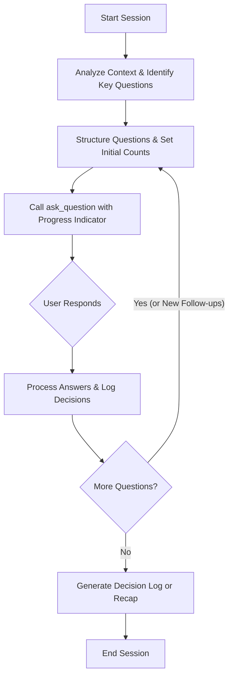

# Interactive Mode

Use this skill to guide the user through a structured, interactive back-and-forth questionnaire. It helps resolve plan designs, clarify ambiguous requirements, grill architectural decisions, and build consensus without dumping walls of text or guessing the user's intent.

## Core Directives

### 1. Pacing & Conciseness
*   **Keep it short:** Limit any introductory text in your messages to a maximum of 2–3 sentences. Let the interactive question tool do the talking.
*   **Group logically:** You may ask multiple related questions in a single `ask_question` call if they are part of the same design decisions block. Otherwise, ask them in sequence.

### 2. Tool Usage & Options
*   **Use the tool:** Always present questions using the `ask_question` tool.
*   **No manual 'Other' option:** Do NOT include a choice like "Other" or "Write-in" in the options list. The UI automatically appends a write-in option.
*   **Recommended options:** When appropriate, mark one option as `[Recommended]` and include a concise rationale.

### 3. Dynamic Progress Tracking
*   **State progress:** Always prefix the question prompt in the tool with the progress counter (e.g., `[Question 2 of 4]`).
*   **Dynamic adjustment:** As the user answers, you can add new follow-up questions or prune redundant questions. Adjust the total count (e.g., `2 of 5` or `2 of 3`) as the scope of the discussion changes.

### 4. No Unconfirmed Assumptions
*   If a user's write-in answer is ambiguous or presents new possibilities, do not assume their choice. Formulate a clarifying follow-up question and ask it.

---

## Execution Workflow

### Phase 1: Intake & Question Formulation
1. Read the active documents and recent conversation history.
2. Outline the design decisions, requirements, or plan parameters that require user feedback.
3. Formulate the list of questions, possible choices, and estimate the initial count.

### Phase 2: Interactive Question Loop
1. Prepare the `ask_question` tool call.
2. For each question, ensure the question string begins with `[Question X of Y]`.
3. In your chat message, provide 1-3 sentences of context explaining why this question is important. Do not write a long essay.
4. Execute the tool and wait for the user's response.
5. Review the user's choices or write-in responses. If they lead to new design branches, update your list of remaining questions and the total count.
6. **Interrupt Handling:** If the user asks a question, gives an instruction, or challenges an option, pause the loop to address their query directly before resuming.

### Phase 3: Session Wrap-up & Artifact Generation
1. **Decision Log / Recap:** Output a structured summary of all agreed-upon variables, decisions, and constraints.
2. **Artifact Generation (if applicable):** If the session was initiated to compile an artifact (e.g., a code file or implementation plan), ask for final sign-off (e.g., *"Do these parameters look correct? Reply `yes` to generate the final artifact."*) before performing the generation.