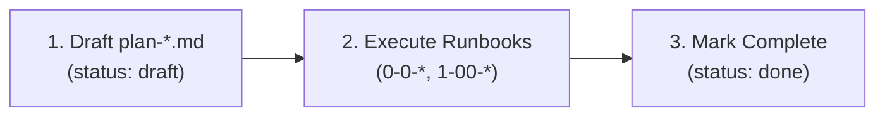
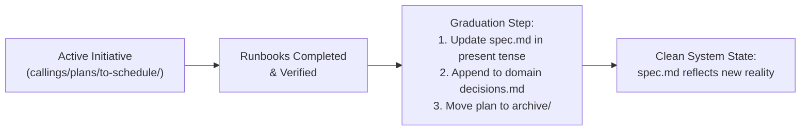

# SpecOps Flow Evolution Plan: Durable System Specs & Progressive Formalization

**Status:** Proposed / Draft  
**Target:** [`spec-ops-flow`](file:///c:/stuff-john/github/ai-docs/skills/spec-ops-flow/SKILL.md) skill in `ai-docs`  
**Author:** Pair Programming Session  
**Updated:** 2026-08-16  

---

## 1. Executive Summary & Design Vision

### Problem
SpecOps Flow currently treats every feature folder as a transient initiative that freezes when shipped. In mature or long-lived codebases (like MyWard or Family Connect), core subsystems (`callings`, `people`, `story-time`) need **durable, living documentation** that describes how the system operates *right now* in production. 

Other systems (like OpenSpec) solve this with rigid requirement grammars (`SHALL`), AST diff tools, and mandatory CLI merges. SpecOps aims to solve this with **progressive formalization** and **pure Markdown conventions**—keeping things completely lightweight for quick tasks while providing an effortless path to durable system specs when subsystems mature.

### Key Innovations
1. **The Four Pillars (WHAT $\rightarrow$ CHANGE $\rightarrow$ HOW $\rightarrow$ WHY):** Clear separation of present reality, proposed changes, technical execution, and historical rationale.
2. **Isomorphic Plan Folders:** The internal structure of a standalone one-off plan is 100% identical to a plan nested inside a domain. Moving a plan into a domain is a zero-friction folder move with zero broken links.
3. **Strictly Optional Durability:** Brownfield tasks or quick spikes start flat with zero boilerplate (no `spec.md`, no `readme.md`). Domains only introduce `spec.md` when the developer wants long-term consolidation.
4. **Clean Grammar Separation:** Living specs are written in authoritative present tense ("how it is"); change plans are written in delta/comparative terms ("why we are changing X to Y").

---

## 2. The Four Pillars of Documentation

Every document in a SpecOps repository answers one of four sequential questions:

```text
1. WHAT     "What is it now?"              spec.md (Current system spec; optional for one-offs)
   ↓
2. CHANGE   "Change it to be what?"        plan.md (Problem, proposed delta, scope boundaries)
   ↓
3. HOW      "How are we going to do it?"   0-0-work-breakdown.md, 1-00-*.md (Runbooks)
   ↓
4. WHY      "Why did we make the choices?" decisions.md (Append-only decision log)
```

| Pillar | File | Scope / Role | Voice & Grammatical Rule |
| :--- | :--- | :--- | :--- |
| **WHAT** | `spec.md` | Permanent domain source of truth. | **Timeless Present-Tense:** "This is how the system works." No PR history, no legacy debates, no ticket numbers. |
| **CHANGE** | `plan-*.md` or `plan.md` | Proposal for a specific initiative. | **Comparative / Delta:** "Because of problem X, we are changing Y to Z." Defines goals, non-goals, and scope. |
| **HOW** | `0-0-...`, `1-00-...` | Technical execution runbooks. | **Imperative / Step-by-Step:** Code snippets, terminal commands, verification steps. |
| **WHY** | `decisions.md` | Historical rationale log. | **Append-Only Log:** `Date \| Status \| Summary` capturing trade-offs, pivots, and defers. |

---

## 3. Structural Shapes

### Shape A: Standalone One-Off (No `spec.md`, No `readme.md`)
*Best for: quick UI tweaks, isolated bugfixes, spikes, or early brownfield prototyping.*

```text
specops/display-density/
  ├── plan-display-density.md        [CHANGE & WHAT combined]
  ├── decisions.md                   [WHY: Tactical choices during build]
  ├── 0-0-work-breakdown.md          [HOW: Sequencing & groups]
  └── 1-00-tokens.md                 [HOW: Runbook]
```

* **Characteristics:**
  * Maximum velocity, zero boilerplate.
  * No `readme.md` (unnecessary for small self-contained plans).
  * Lives directly at `specops/<feature>/` (or in the `specops/plans/<feature>/` drawer).

---

### Shape B: Domain Area (with `spec.md`)
*Best for: core subsystems that endure across multiple iterations (`callings`, `people`, `sacrament-planning`).*

```text
specops/
  ├── callings/                      ★ DOMAIN ROOT
  │   ├── readme.md                  Entrypoint & domain navigation
  │   ├── spec.md                    [WHAT: Authoritative current system description]
  │   ├── decisions.md               [WHY: Domain-wide architectural rules & policies]
  │   │
  │   ├── plans/
  │   │   └── to-schedule/           ★ SELF-CONTAINED INITIATIVE (Shape A inside)
  │   │       ├── plan-to-schedule.md
  │   │       ├── decisions.md       [WHY: Sprint-specific tactical choices]
  │   │       ├── 0-0-work-breakdown.md
  │   │       └── 1-00-legacy.md
  │   │
  │   └── archive/
  │       └── 2025-09-mvp1/          [RETIRED INITIATIVE TIME-CAPSULES]
  │           ├── plan-mvp1.md
  │           └── 1-00-polish.md
  │
  └── plans/                         ★ ONE-OFF / UNGROUPED DRAWER
      └── display-density/           (Holds standalone Shape A plans)
```

---

## 4. Lifecycle & Workflows

### 1. Standalone Plan Lifecycle (Shape A)

* **Completion:** Once runbooks finish, mark `status: done` on `plan-*.md`. The folder remains as a clean historical record or can move to `specops/archive/`. No parent spec exists to update.

---

### 2. Domain Graduation Lifecycle (Shape B)


When an active initiative in `callings/plans/to-schedule/` finishes:
1. **Update `spec.md`:** Bring `spec.md` up to date with the delivered capabilities (e.g. adding the `To Schedule` pipeline stage and `notes` property), written cleanly in present tense.
2. **Record Domain Decisions:** If the initiative established new domain-wide architectural rules (e.g. *"All status transitions must be reversible"*), append them to `<domain>/decisions.md`.
3. **Archive the Plan Folder:** Move `plans/to-schedule/` $\rightarrow$ `archive/to-schedule/`.

---

### 3. Progressive Consolidation (Promoting Standalone Plans into a Domain)
When multiple standalone plans accumulate around a subsystem:
1. Create `specops/<domain>/`.
2. Move the standalone plan folder into `specops/<domain>/plans/<feature>/`. *(Zero link breakage because the plan is internally self-contained).*
3. Author `specops/<domain>/spec.md` summarizing current subsystem reality.
4. Move any remaining unrelated one-offs into `specops/plans/`.

---

## 5. Decision Log Scoping Rules

To prevent macro-level domain logs from being cluttered by microscopic implementation details:

| Scope | Location | What Belongs Here | Example |
| :--- | :--- | :--- | :--- |
| **Plan-Level** | `plans/<feature>/decisions.md` | Tactical implementation choices, bug workarounds, component-local decisions. | *"Used native `<select>` over Angular CDK dropdown due to mobile focus bug."* |
| **Domain-Level** | `<domain>/decisions.md` | Subsystem architectural rules, data model constraints, cross-plan policies, security boundaries. | *"Preserve backward compatibility with legacy Firestore schema."*<br>*"Single-ward scope only; no multi-unit sync."* |

---

## 6. Detailed Skill Modification Checklist

### A. Root Detection Logic (`SKILL.md`)
Update the ancestor walk algorithm:
* **Plan Root:** Walk up to the nearest ancestor containing `plan-*.md` or `plan.md`. Scopes runbooks, work breakdown, and plan-local `decisions.md`.
* **Domain Root:** Walk up to the nearest ancestor containing `spec.md`.
  * *Boundary Check:* If you walk up to `specops/` without encountering a `spec.md`, there is **no domain root** (the plan is operating in standalone mode).

---

### B. Frontmatter Spec (`frontmatter-spec.md`)
Formalize document typing:
* **`spec.md` Frontmatter:**
  ```yaml
  ---
  type: spec
  updated: 2026-08-16
  notes: Authoritative domain spec for Callings subsystem.
  ---
  ```
* **`plan-*.md` / `plan.md` Frontmatter:**
  ```yaml
  ---
  type: plan
  status: in-progress     # draft | todo | in-progress | done
  updated: 2026-08-16
  notes: Introducing To Schedule pipeline status and proposal notes.
  ---
  ```

---

### C. Guides to Create or Update
1. **`guides/spec.md` (NEW):**
   * How to write and maintain a durable system spec.
   * Directives: Present-tense only, capabilities, data models, UX flows, invariants.
   * Prohibitions: No "we changed from A to B", no PR references.
2. **`guides/plan.md` (UPDATED from `feature-plan.md`):**
   * How to author a Change Plan (Problem, Proposed Delta, Scope, Non-Goals).
   * Renaming from `feature-*.md` to `plan-*.md` (or `plan.md`).
3. **`guides/archive.md` (UPDATED):**
   * Adds the **Domain Graduation Flow**: Updating `spec.md`, logging to domain `decisions.md`, and moving `plans/<name>/` to `archive/<name>/`.
   * Retains simple archiving for standalone one-offs.
4. **`guides/status.md` (UPDATED):**
   * Scans active runbooks within the current Plan Root.
   * If invoked at Domain Root, summarizes all active plans under `plans/`.

---

### D. Templates to Create or Update
1. **`templates/spec.md` (NEW):** Sections: Purpose, System Capabilities, UX & Workflow State Machines, Data Models & Contracts, Business Invariants.
2. **`templates/plan.md` (UPDATED):** Sections: Problem, Proposed Changes, UX Delta, System Impact, Decisions, Success Criteria.
3. **`templates/decisions.md` (UPDATED):** Clean table with instructions distinguishing plan vs. domain scope.
4. **`templates/domain-readme.md` (UPDATED):** Overview, link to `spec.md`, active plans in flight, archived initiatives.

---

## 7. Migration Strategy for Existing Repositories

For repos currently using SpecOps v1 (e.g. MyWard or Family Connect):
1. **Existing `feature-*.md` files:**
   * If the folder is a durable subsystem (like `callings`): rename `feature-callings.md` $\rightarrow$ `spec.md`, clean up historical notes to be pure present-tense, and create `plans/` for active work.
   * If the folder is a one-off (like `display-density`): rename `feature-display-density.md` $\rightarrow$ `plan-display-density.md`.
2. **Backwards Compatibility:**
   * The skill will treat legacy `feature-*.md` as an alias for `plan-*.md` so existing unmigrated projects continue to function without errors.
